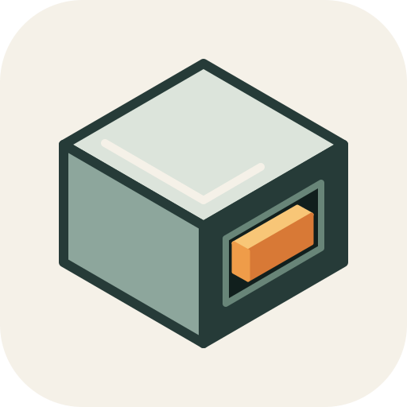
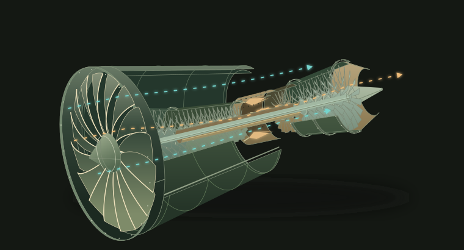
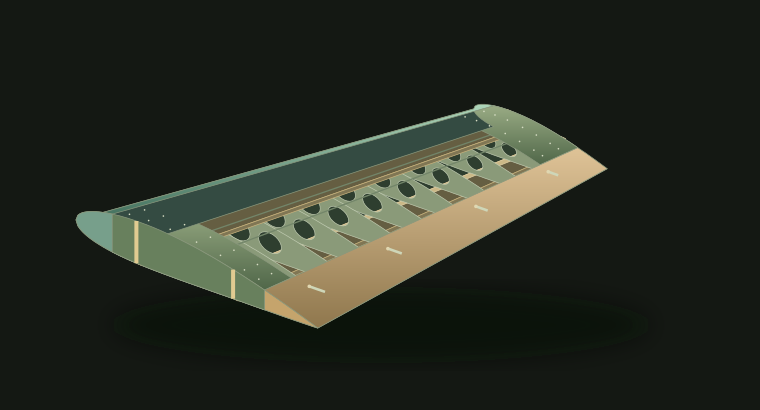
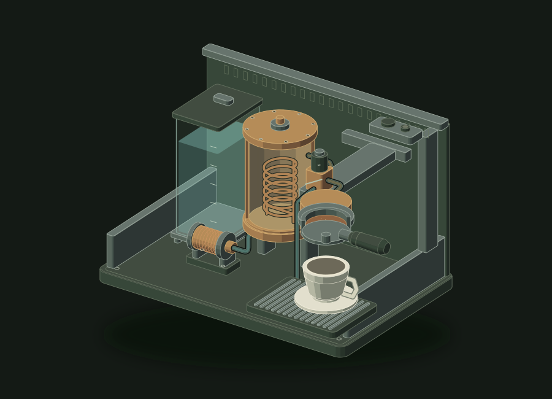
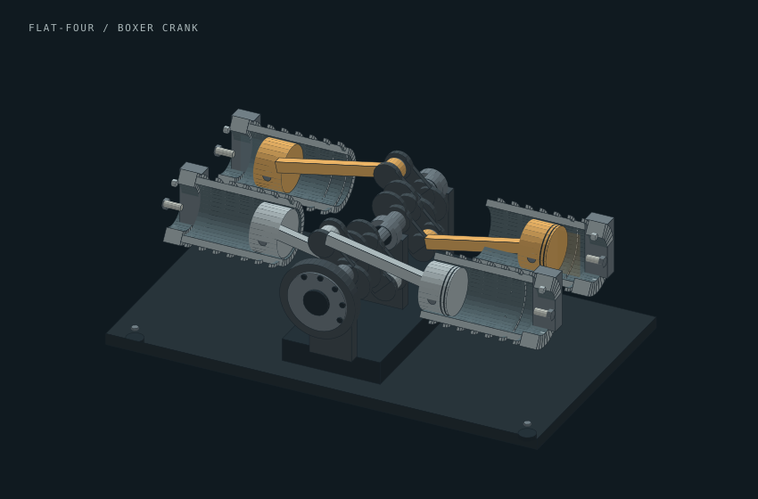

# Cutaway



/anatomy, adapted for ChatGPT.

Cutaway is a ChatGPT plugin for learning how machines work. Look inside the GE9X jet engine, follow water through an espresso machine, compare wing designs, or study the pistons and crankshaft in a boxer engine.

Open a finished model, select a component, and move its controls. The plugin returns explanations, source links, and HTML or SVG downloads of the selected view. Its bundled skill can also draw other machines using the file and code tools in your ChatGPT session. Neither path needs a separate API key.

The drawing toolkit and illustration guidance come from [Ryan's (@wheresryan22) Anatomy](https://github.com/wheresryan22/anatomy). Cutaway adapts that work for ChatGPT and adds the plugin, demos, and file delivery instructions.

## Use in ChatGPT

Public installation is coming soon. Once installed, select **Cutaway** using `@` in a new conversation and describe the machine you want to understand.

Workspace admins can build the [marketplace package](#packaging) and follow the [workspace import instructions](https://learn.chatgpt.com/docs/enterprise/plugin-management). For local development, see the [plugin setup guide](https://developers.openai.com/plugins/build/plugins).

Try “Show the GE9X compressor,” “Extend the wing flaps to 25 degrees,” or “Open the espresso machine while brewing.” The model opens inside compatible ChatGPT clients, with links to open it in a browser or download the selected view. Custom cutaways use the bundled drawing skill.

## Demos and prompts

These previews show the finished hardware demos. Each demo runs offline and includes controls, sources, and an explanation of its simplifications. Animations start paused.

[Build the demos locally](#development), or use the prompts below to create your own cutaways in ChatGPT.

### GE9X jet engine



```text
Build a GE9X cutaway using GE Aerospace's published references: the 16-blade fan,
3-stage booster, 11-stage compressor, 2 high-pressure and 6 low-pressure turbine
stages, and concentric shafts. Separate core and bypass airflow, and let me select
parts and pause the flow. Explain the simplifications and include sources.
```

### Wing designs



```text
Build a wing cutaway with spars, ribs, flaps, and slats. Let me compare rectangular,
tapered, and swept wings. Explain what changes when the high-lift devices extend.
```

### Espresso machine



```text
Build a cutaway espresso machine with a reservoir, pump, boiler, brew valve,
group head, and portafilter. Trace the water into the cup and let me step through
heating and brewing.
```

### Boxer engine



```text
Build a 4-cylinder boxer cutaway with horizontally opposed pistons and separate
crankpins. Let me turn the crankshaft and follow an opposing piston pair.
Explain why the opposing pistons move together.
```

## Optional glow

Cutaway includes 2D SVG lighting and palettes from [April Zhu's iso-glow](https://isoglow.dev/), based on Tolga Cohce's iso-figure. Ask for glow to highlight active parts or flow paths in dark mode. For an espresso machine, add:

```text
Use 2D glow in dark mode. Light up the water path while pumping and the heater
while heating. Include technical/glow and light/dark controls.
```

The [glow guide](skills/cutaway/glow/guide.md) covers palettes, filters, and how to use them in editable drawings.

## Development

Use Bun and Node.js 22 or newer. Packaging also needs the system `zip` and `unzip` commands.

```sh
bun install --frozen-lockfile --ignore-scripts
bun run check
bun run test
bun run build:site
bun run preview:site
```

Open `http://127.0.0.1:4322`. The preview serves the website and MCP endpoint at `/mcp`. The website is in `site/`, the ChatGPT bridge in `app/`, and the server in `server/`. `build:site` also rebuilds the release archives.

The output includes a Cloudflare Pages worker. Static hosting serves the demos; the MCP endpoint and selected-view exports need a runtime. Deployment configuration stays local.

To build only the hardware demos:

```sh
bun run hardware
```

Open `dist/hardware/index.html`. Each demo has a self-contained HTML file and a standalone SVG, with source in `site/hardware/`.

After building, run `bun run check:site`, `bun run check:hardware`, and `bun run check:mcp`. These check links, controls, MCP requests, view exports, and the host bridge. Check layout and motion in a browser after changing drawings or controls. Local checks don’t establish that ChatGPT or Cloudflare has run the build.

## MCP service

The service exposes `list_cutaways`, `open_ge9x`, `open_wing`, `open_espresso`, and `open_boxer`. Each open tool accepts settings for its model and returns a view, an explanation, limitations, sources, and HTML/SVG export links. It provides public educational content without authentication, accounts, saved sessions, or an external model API.

The UI uses the MCP Apps bridge. Controls run locally; “Discuss this view” sends the current settings to the conversation. Downloads preserve the selected state and the applicable license notices. All animation starts paused.

For a development connection, use a reachable HTTPS endpoint ending in `/mcp` and no authentication. See OpenAI’s [connection instructions](https://developers.openai.com/plugins/build/app-quickstart). Public directory installation is pending.

## Packaging

```sh
bun run package
```

This creates `dist/cutaway-<version>.zip` and `dist/workspace-marketplace/`, using the version in [plugin.json](plugin.json). The plugin contains the drawing toolkit, generation instructions, and remote MCP connection in [mcp.json](mcp.json). The server deploys with the website; the offline demos also ship separately.

For workspace import, copy the contents of `dist/workspace-marketplace/` into a GitHub repository, preserving the hidden `.agents` directory. Reimport or reinstall the package after rebuilding to use the changes.

Run `bun run release` to build `dist/releases/<version>/`. It contains plugin, source, marketplace, hardware, and software-example archives, plus `SHA256SUMS`. Copy exported source outside `dist/` before editing it; builds replace generated files.

## Credits and license

Cutaway's original code, demos, and website use the [MIT license](LICENSE), copyright © 2026 Abhay Kumar. Bundled Anatomy and iso-glow code keeps its original copyright and MIT notices.

See [THIRD_PARTY.md](THIRD_PARTY.md) for upstream sources, local changes, and license details.
